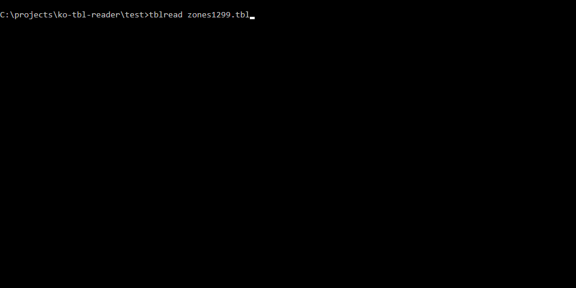

# Knight Online TBL Reader

This simple application designed to read knight online tbl files.



## Install

- install node.js
- optional: type in terminal `npm i ko-tbl-reader -g`

## Usage

- type in terminal `npx ko-tbl-reader Zones.tbl`

## Tips

You may create decrypted json by simply typing;

```sh
npx ko-tbl-reader -j Zones.tbl
```

With korean encoding

```sh
npx ko-tbl-reader -j -k Zones.tbl
```
## Writing tbl files

Export a table to json, edit it, and build a `.tbl` from it again:

```sh
npx ko-tbl-reader -j Zones.tbl > Zones.json
# edit Zones.json
npx ko-tbl-reader Zones.json -o Zones.tbl
```

The written file uses the encryption the json was read with (its `encryption`
field). Use `-e` to pick another one: `plain`, `standard`, `standard-0418` or
`double`. A `.tbl` input works too, which re-encrypts a table:

```sh
npx ko-tbl-reader Zones.tbl -o Zones_plain.tbl -e plain
```

Use `-k` on both sides when the strings are korean (euc-kr). `double` tables
carry 5 unknown bytes in front of the table; the json keeps them as `prefix`
so they are written back unchanged (zeros when missing).

From code:

```js
const tbl = require("ko-tbl-reader");

const table = await tbl("Zones.tbl"); // { encryption, columns, rows, ... }
table.rows[0][2] = "new name";
await tbl.writeTbl("Zones.tbl", table); // or tbl.toTbl(table) for a Buffer
```
